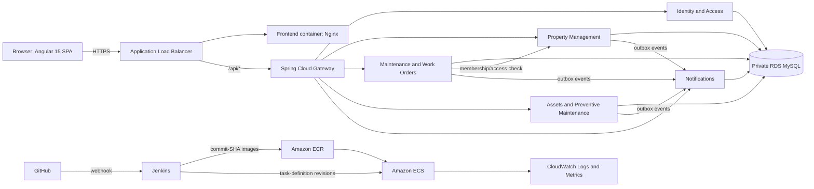

# Property & Facility Maintenance Management System

## Project status

**Phase 2 scaffolding is in progress.** The repository now has a Maven multi-module backend skeleton for the gateway and five independently deployable Spring Boot services, local MySQL configuration, and Docker Compose. Business workflows, real authentication/token issuance, the Angular workspace, Jenkins, Terraform, and AWS deployment are not implemented. The existing `.idea/` files are local IDE metadata and should not be treated as application source.

The goal is a property and facility maintenance platform for managers, tenants, technicians, and system administrators. The design aims for clear service ownership and credible production practices while keeping local development and demonstration costs manageable for a single developer.

## Architecture

The initial system is a monorepo with independently deployable Spring Boot services. The browser talks to a versioned API through a gateway. Domain services own their data and migrations; no service reads another service's database.



The ALB is the public HTTPS entry point and routes web and API traffic. Spring Cloud Gateway handles application-level routing, correlation IDs, request limits, and coarse authentication-related policies. Each domain service remains responsible for its own authorization. AWS API Gateway is a separate AWS-managed product and is not part of this initial design.

Use REST for synchronous cross-service checks. Use a transactional outbox and idempotent event handling for notification delivery, avoiding a message broker in the first release. Add a broker such as SQS only if operational needs justify its additional cost and complexity.

### Service responsibilities

| Service | Data and responsibilities |
|---|---|
| API Gateway | No business database. Routes versioned API traffic, applies request limits, and propagates validated correlation IDs. |
| Identity and Access | Users, credentials, roles, account status, authentication audit, token issuance, and public verification keys. |
| Property Management | Properties, buildings, floors, units, property membership, manager/tenant associations, and authoritative property-level access checks. |
| Maintenance and Work Orders | Maintenance requests, comments, work orders, assignments, workflow history, and status transitions. |
| Assets and Preventive Maintenance | Assets, schedules, due tasks, service/maintenance records, and overdue calculations. |
| Notifications | Notification records, idempotency keys, delivery attempts, and configurable email delivery (mocked locally). |

Each service should have its own migrations, runtime credentials, validation, API models, health endpoint, and deployable container. The services may share one RDS instance for a small demonstration, using separate logical databases and least-privilege credentials. This is a cost-saving trade-off, not equivalent to dedicated database instances or infrastructure isolation.

## API outline

Expose versioned JSON APIs under `/api/v1`. Use explicit request/response DTOs, Bean Validation, UTC timestamps, and common pagination, sorting, and filtering conventions (`page`, `size`, `sort`). Do not expose JPA entities or accept an actor/user ID from a client when it can be derived from the authenticated principal.

| Area | Example endpoints |
|---|---|
| Identity | OIDC authorize/token/JWKS endpoints; `GET /api/v1/users/me`; admin-only `GET/POST /api/v1/users` |
| Properties | `GET/POST /api/v1/properties`; `GET/PUT /api/v1/properties/{propertyId}`; `GET /api/v1/properties/{propertyId}/units` |
| Maintenance requests | `POST/GET /api/v1/maintenance-requests`; `GET /api/v1/maintenance-requests/{requestId}`; status and comment subresources |
| Work orders | `GET/POST /api/v1/work-orders`; assignment, status, and history subresources |
| Assets | `GET/POST /api/v1/assets`; `GET /api/v1/assets/{assetId}`; maintenance schedule and due-task endpoints |
| Reports | Property-scoped status, priority, overdue, resolution-time, and technician-workload reports with date filters |

The maintenance workflow states are `OPEN`, `APPROVED`, `ASSIGNED`, `IN_PROGRESS`, `ON_HOLD`, `RESOLVED`, and `CLOSED`. Define allowed state transitions and required fields explicitly; reject disallowed transitions with `409 Conflict`.

All services should return a consistent error envelope:

```json
{
  "timestamp": "UTC timestamp",
  "status": 400,
  "code": "VALIDATION_ERROR",
  "message": "Request validation failed",
  "path": "/api/v1/example",
  "correlationId": "request correlation ID",
  "fieldErrors": []
}
```

Use appropriate HTTP statuses, including `200`, `201`, `204`, `400`, `401`, `403`, `404`, `409`, and `500`. Publish OpenAPI documentation for each service.

## Data ownership and database plan

Target MySQL 8.4 LTS where it is supported by the selected RDS region and configuration. Use InnoDB, Flyway migrations, indexes, constraints, and transactions. Store identifiers as UUIDs (`BINARY(16)` internally, canonical UUID strings in APIs) and timestamps as UTC `DATETIME(6)`. Verify database engine/version availability before provisioning.

| Owning service | Initial tables | Example indexing needs |
|---|---|---|
| Identity | `users`, `roles`, `user_roles`, `password_reset_tokens`, `audit_events` | Unique normalized email; account status and role lookups |
| Property | `properties`, `buildings`, `floors`, `units`, `property_memberships` | Property, user, and unit membership lookups |
| Maintenance | `maintenance_requests`, `maintenance_comments`, `work_orders`, `work_order_assignments`, `work_order_history`, `outbox_events` | Property/status/priority, assignee/status, due date, event delivery |
| Assets | `assets`, `maintenance_schedules`, `maintenance_tasks`, `maintenance_records`, `outbox_events` | Property, asset identifier, next due date, task status |
| Notifications | `notifications`, `delivery_attempts`, `processed_events` | Unique event/idempotency key, delivery status, retry time |

Use foreign keys only within a service-owned database. Cross-service IDs such as `propertyId`, `unitId`, and `userId` are references, not cross-database foreign keys. Property Management remains the source of truth for memberships; dependent services request authorization rather than reading or maintaining a second membership database.

## Frontend architecture

Use Angular **15** with a consistent NgModule architecture and lazy-loaded feature modules. Organize the application by core/shared/feature responsibilities:

```text
frontend/
  src/app/
    core/          authentication, guards, interceptors, layout, API services
    shared/        reusable components, validators, pipes, directives
    features/      dashboard, properties, tenants, users, requests, work-orders,
                   assets, preventive-maintenance, notifications, reports
    app-routing.module.ts
    app.module.ts
```

Build a responsive application shell with navigation, header, breadcrumbs, and loading/error feedback. Reuse Material components for forms, dialogs, paged/searchable tables, status and priority badges, and empty states. Feature modules own their pages and reactive forms; typed API services own HTTP calls. Components should handle observable results and loading/error states without duplicating API logic.

Use route guards for navigation and an HTTP interceptor for bearer headers and shared error handling. Neither is a security boundary: every API operation must be authorized by the backend. Configure CORS for known frontend origins and API URLs via environment configuration. Prefer in-memory access-token handling over `localStorage`.

## Authentication and authorization

Use Authorization Code with PKCE for the SPA and short-lived signed JWT access tokens. The Identity service publishes verification keys via JWKS; domain services validate issuer, audience, expiry, and signature. Use a Spring-supported password encoder such as BCrypt. Do not create custom cryptography or log passwords, tokens, or credentials.

| Role | Scope |
|---|---|
| `SYSTEM_ADMIN` | System-wide configuration and user administration |
| `PROPERTY_MANAGER` | Operations for assigned properties |
| `TENANT` | Own requests and authorized unit/property information |
| `TECHNICIAN` | Work orders assigned to the technician and permitted work updates |

For v1, omit refresh tokens and require reauthentication after access-token expiry. Clearing the client token at logout does not instantly revoke an already issued stateless access token; document this limitation. Add server-side refresh/revocation only if required by the product workflow. Property-scoped checks must be made against Property Management and fail closed when that service cannot authorize the operation.

## CI/CD and AWS deployment

1. Protect the deployment branch and require review and passing validation. Configure a GitHub webhook to Jenkins.
2. Run pull-request checks for Java compilation/tests, Angular build/tests/lint, dependency checks, and static analysis. Pull requests do not deploy to production.
3. On an approved push to the configured branch, build images tagged with the immutable Git commit SHA and push them to ECR using Jenkins-managed credentials and a least-privilege AWS role.
4. Register ECS task-definition revisions and update only intended ECS services. Prevent concurrent deployments.
5. Wait for deployment stability and run health checks. Fail on a bad deployment; roll back to the previous known-good image and task-definition revision.

Use Terraform consistently for infrastructure as code. Keep RDS private. Use task execution roles and service-specific runtime roles, resource limits, health checks, and CloudWatch log retention. Do not embed credentials or account IDs in source, images, Jenkinsfiles, or Angular bundles.

### Cost and eligibility checklist

**Do not provision AWS resources without reviewing a current account- and region-specific estimate and obtaining approval.** Free Tier/Free Plan benefits depend on account eligibility, signup date, plan, service, region, limits, and current terms. Credits or allowances are not a guarantee that this architecture is free.

Check current documentation and pricing before deployment:

- [AWS Free Tier](https://aws.amazon.com/free/)
- [Amazon RDS for MySQL pricing](https://aws.amazon.com/rds/mysql/pricing/)
- [Amazon ECS Fargate](https://docs.aws.amazon.com/AmazonECS/latest/developerguide/AWS_Fargate.html)
- [Amazon VPC pricing](https://aws.amazon.com/vpc/pricing/)
- [AWS Pricing Calculator](https://calculator.aws/)

Budget for ECS/Fargate CPU and memory runtime, ALB hours and capacity units, public IPv4 addresses, data transfer, RDS instance-hours/storage/backups/snapshots, NAT gateway hours and data, CloudWatch ingestion/storage, ECR image storage, secrets, email delivery, DNS/domain, and Jenkins hosting. Stopping RDS does not eliminate storage and backup charges. Billing alerts notify; they do not cap spending.

Fargate avoids managing EC2 capacity but is not necessarily the lowest-cost choice for continuously running tasks. Compare Fargate with ECS on EC2 using measured task sizes, uptime, region, networking, and database requirements. Six always-on services incur meaningful compute cost. Avoid NAT gateways where feasible, but do not misrepresent private subnet egress as free. If considering public-subnet tasks for a temporary demo, allow inbound traffic only from the ALB and document the security trade-off.

Before deployment, create billing alerts and a cleanup checklist covering ECS services/tasks, ALB, RDS, snapshots, NAT gateways, public IPs, ECR images, log groups, secrets, and other networking resources. Verify deleted resources in the console and billing views afterward.

## Dependency compatibility

| Component | Planned baseline and caveat |
|---|---|
| Angular | Angular/CLI/Material 15.2.x, as required. Angular 15 is out of support and is a security/maintenance risk. |
| Frontend tooling | Angular 15.2 requires a compatible TypeScript 4.x release (4.9.x baseline), RxJS 7.x, and a compatible Node 18 release. Node 18 is also end-of-life; isolate this build toolchain and plan an Angular upgrade. Verify exact compatibility in Angular's [version table](https://angular.dev/reference/versions). |
| Java | Java 21 LTS |
| Spring Boot | Spring Boot 3.5.16, Java 21; pinned in the backend parent POM |
| Spring Cloud Gateway | Spring Cloud 2025.0.3 BOM and Gateway WebFlux starter, aligned to the Boot 3.5 line. Verify support status before production use in [Spring Cloud documentation](https://spring.io/projects/spring-cloud#release-trains). |
| Persistence/migrations | Spring Data JPA, Hibernate, MySQL Connector/J, and Flyway versions managed/verified against the selected Boot BOM; include Flyway MySQL support where required |
| Security/API docs | Spring Security OAuth2 Resource Server; verify Spring Authorization Server support if used; springdoc OpenAPI 2.x compatible with the chosen Boot 3 line |
| Testing/build | Maven Wrapper, JUnit 5, Mockito, Spring Boot Test, and Testcontainers MySQL for database integration tests |
| Infrastructure | Terraform with a pinned version; Java 21 runtime containers and non-root frontend/backend images |

**Production support caveat:** Angular 15 is explicitly required but unsupported. The required Angular toolchain has end-of-life components, and Spring Boot/Spring Cloud maintenance status can change. Recheck supported versions and exact compatibility immediately before Phase 2. This document does not assert that a version is production-supported solely because it meets the major-version requirement.

## Prioritized implementation backlog

1. **Phase 2 — Scaffold:** Monorepo conventions, Angular workspace, Maven services, local configuration, Dockerfiles, Docker Compose, MySQL, and health endpoints.
2. **Phase 3 — Identity and property access:** Authentication, roles, user administration, property/unit/membership APIs, migrations, and property-isolation tests.
3. **Phase 3 — Maintenance workflow:** Requests, comments, approvals, assignments, state transitions, history, pagination, reports, and workflow/security tests.
4. **Phase 3 — Assets and notifications:** Asset inventory, schedules/due tasks, outbox delivery, idempotency, and local mock email.
5. **Phase 4 — Angular application:** Shell, login, lazy routes, dashboard, property and maintenance workflows, then assets and reports; add API, guard, interceptor, form, and state tests.
6. **Phase 5 — Local integration:** Run and test the end-to-end tenant/manager/technician workflow with Compose; verify migrations and failure handling.
7. **Phase 6 — CI:** Protected-branch Jenkins validation, image build/scanning, ECR publishing, and non-production deployment/rollback checks.
8. **Phase 7 — AWS:** Review account eligibility, region, cost, IAM, network plan, and cleanup steps; provision only after approval.
9. **Phase 8 — Demonstration/docs:** Synthetic demo data, operating guide, API/database/security documentation, and rollback/cleanup walkthrough.

## Decisions and prerequisites

Recommended defaults are Terraform, MySQL 8.4 LTS where supported, UUIDs, UTC, OIDC Authorization Code with PKCE, no refresh tokens in v1, and mock email locally. Decisions still needed before AWS deployment include the account/region and eligibility, whether Jenkins hosting is already available, and whether the Angular 15 and Spring Boot 3.x constraints can be relaxed. None blocks local scaffolding, but each affects supportability or cost.

## Spring Boot scaffold and local development

The backend parent build is `backend/pom.xml`. It targets Java 21, Spring Boot 3.5.16, and Spring Cloud 2025.0.3. The gateway uses the matching Spring Cloud Gateway WebFlux starter; domain services use Spring MVC, JPA, Spring Security resource-server support, Bean Validation, Actuator, Flyway, MySQL, and OpenAPI. Maven Wrapper is available at `backend/mvnw.cmd` (Windows) and `backend/mvnw` (Unix). The versions are pinned for a repeatable scaffold and must be rechecked for support before production use.

Each service has a Spring Boot entry point and separate API, application, and domain status layers. The only application endpoint currently implemented is a non-sensitive scaffold status response at `GET /api/v1/status`; Actuator exposes health/info. Domain APIs and data models are intentionally not implemented yet. Protected API paths require a JWT accepted from the configured JWKS URL; token issuance is a Phase 3 task.

Local MySQL creates five separate databases (`facility_identity`, `facility_property`, `facility_maintenance`, `facility_asset`, and `facility_notification`) with distinct least-privilege service users. Compose uses a named volume so data persists across restarts. The initial database/user script runs only when MySQL initializes an empty data directory. Updating `.env` later does not rotate database users in an existing volume.

1. Copy `.env.example` to `.env`, fill every blank password with a unique local-only value containing letters, digits, `_`, or `-`, and keep `.env` local; it is ignored by Git.
2. Start the database: `docker compose up -d mysql`. On first initialization, the entrypoint creates five logical databases and separate service users.
3. Build and run the backend stack: `docker compose up -d --build`.
4. Check service health at `http://localhost:8081/actuator/health` and status directly at `http://localhost:8082/api/v1/status` through `http://localhost:8086/api/v1/status`.
5. Run backend tests: `backend\\mvnw.cmd -f backend\\pom.xml test`.
6. Stop containers: `docker compose down`. To intentionally delete the local database volume as well, use `docker compose down -v`.

The Spring apps are not yet wired to real frontend workflows, and the Angular workspace has not been generated. Docker Compose is configured but could not be started in the current environment because the Docker Engine was unavailable; the database has therefore not yet been created or launched. No AWS credentials or infrastructure are required for local development. No AWS resources have been provisioned.

**Credential hygiene:** The database credential pasted into the conversation was not copied into the repository or local configuration. If it is real or reused, rotate it anywhere it is used.

**Phase gate:** Phase 2 local Docker verification is still outstanding (deferred by the project owner). Phase 3 work has started with Identity and Access; see below.

## Backend conventions (reference implementation: identity-service)

Each service copies these conventions rather than sharing a library, to keep services independently deployable.

- **Errors:** every failure (validation, auth, 404, 409, 500) uses the JSON envelope shown above, including 401/403 produced by Spring Security. Responses never contain stack traces.
- **Correlation ID:** `X-Correlation-ID` is accepted if it matches `[A-Za-z0-9-]{1,64}`, otherwise generated; it is echoed in the response, placed in the log MDC, and included in error bodies.
- **Pagination:** `page`, `size` (max 100, default 20), `sort=field,dir`; only whitelisted sort fields are accepted (400 otherwise). Responses use `{content, page, size, totalElements, totalPages}`.
- **IDs and time:** UUIDs stored as `BINARY(16)`, serialized canonically; timestamps are UTC `DATETIME(6)` serialized as ISO-8601.
- **Authorization:** enforced in each service with `@PreAuthorize` on role claims, not only at the gateway.

## Identity and Access (implemented)

- Schema (Flyway `V1__identity_schema.sql`): `roles`, `users`, `user_roles`, `audit_events`. Passwords are BCrypt-hashed (12–72 chars enforced); emails are trimmed and lowercased.
- `POST /api/v1/auth/login` (public) with `{email, password}` returns `{access_token, token_type, expires_in}`. It uses a generic 401 for unknown/wrong/disabled accounts and an equal-cost password check for unknown users. Login attempts are audited.
- Tokens are RS256 JWTs (Spring Security/Nimbus) with `iss`, `aud` (`facility-api`), `sub` (user UUID), `roles`, `iat`, `exp` (default 15 minutes), and `jti`. Public keys are served at `GET /oauth2/jwks`.
- `GET /api/v1/users/me` (any valid token; disabled accounts are rejected). SYSTEM_ADMIN only: `GET/POST /api/v1/users`, `GET /api/v1/users/{id}`, `PATCH /api/v1/users/{id}/status`, `PUT /api/v1/users/{id}/roles`. Administrators cannot disable themselves or remove their own admin role.
- Configuration (environment): `IDENTITY_JWT_PRIVATE_KEY_LOCATION` (PKCS#8 PEM RSA key, e.g. `file:/run/secrets/jwt.pem`), `IDENTITY_JWT_ISSUER`, `IDENTITY_JWT_AUDIENCE`, `IDENTITY_JWT_ACCESS_TOKEN_TTL`. Without a key file an **ephemeral key** is generated at startup (local only; tokens die on restart and multiple instances would disagree). Generate a local key outside the repo, e.g. `openssl genpkey -algorithm RSA -pkeyopt rsa_keygen_bits:2048 -out jwt.pem`.
- First administrator: set `IDENTITY_BOOTSTRAP_ADMIN_EMAIL` and `IDENTITY_BOOTSTRAP_ADMIN_PASSWORD` locally; it is created only if the user table is empty. No credentials are in source or migrations.
- Tests: `backend\mvnw.cmd -f backend\pom.xml -pl services/identity-service -am test` (unit, `@DataJpaTest`, and MockMvc security tests on in-memory H2 in MySQL mode). Testcontainers MySQL tests are planned once Docker is available.

**Known limitations (Identity):** no OIDC Authorization Code + PKCE flow yet (direct credential login is used until the SPA phase); no login throttling/lockout; no refresh tokens or revocation (issued tokens stay valid until expiry); password reset is not implemented; other services do not yet validate the `aud` claim or consume `roles` (to be done in their phases); MySQL-specific schema validation was run once manually against a throwaway local MySQL 8.0 instance (Flyway migration, Hibernate `validate`, login, `/users/me`, admin user creation, 401/403 handling, JWKS, and routing/JWT validation through the gateway). That check is not automated; Testcontainers tests are planned. Docker Compose has still not been run, so container builds and the Compose network path are unverified.

## Property Management (implemented)

- Schema (Flyway `V1__property_schema.sql`): `properties`, `buildings`, `floors`, `units`, `property_memberships`. `user_id` values reference Identity users logically only (no cross-database FK; the service does not verify the user exists).
- Access model: SYSTEM_ADMIN sees all properties; everyone else only properties where they hold a membership (`PROPERTY_MANAGER`, `TENANT` bound to a unit, or `TECHNICIAN`). Callers with no relationship to a property get **404** (existence is not disclosed). Authorization is centralized in `PropertyAccessService`.
- Endpoints under `/api/v1/properties`: `POST` (admin only), `GET` (scoped, paginated), `GET/PUT /{id}`, `GET /{id}/access` (authoritative access answer for other services), `POST/GET /{id}/buildings`, `POST/GET /{id}/buildings/{bid}/floors`, `POST/GET /{id}/units`, `GET /{id}/units/{uid}` (tenants only see their own units), `POST/GET /{id}/memberships`, `DELETE /{id}/memberships/{mid}` (admin or property manager). Duplicates return 409; invalid input or sort fields return 400.
- JWT validation: signature via the identity JWKS (`JWT_JWK_SET_URI`), expiry, issuer (`IDENTITY_JWT_ISSUER`) and audience (`IDENTITY_JWT_AUDIENCE`); `roles` claim is mapped to `ROLE_*` authorities.
- Tests: `backend\mvnw.cmd -f backend\pom.xml -pl services/property-service -am test` (MockMvc on H2; includes cross-property isolation tests).

**Known limitations (Property):** no soft-delete/deactivation endpoint; no update/delete for buildings, floors, units; membership user ids are not validated against Identity; the MySQL path was verified once manually (Flyway migration, Hibernate validate, admin-created property, cross-service JWT validation against a live identity-service, 401 handling) but is not automated; Testcontainers tests are planned.

## Maintenance and Work Orders (implemented)

- Schema (Flyway `V1__maintenance_schema.sql`): `work_orders`, `work_order_comments`, `work_order_status_history`. Property/unit/user ids are logical references only (no cross-service FKs).
- Property scoping: maintenance-service never reads the property database. It forwards the caller's bearer token to property-service (`GET /api/v1/properties/{id}/access`, and `/members/{userId}/access` to validate assignees) using `PROPERTY_SERVICE_URL` (default `http://localhost:8083`), with connect/read timeouts and at most 2 attempts (GET only). Any failure other than 403/404 fails closed with **503** `DEPENDENCY_UNAVAILABLE`.
- Lifecycle: `OPEN -> APPROVED -> ASSIGNED -> IN_PROGRESS <-> ON_HOLD -> RESOLVED -> CLOSED`; `OPEN -> REJECTED` is an extra terminal state. Invalid transitions return **409**; stale concurrent updates (optimistic lock) also return 409. Transitions use `POST /api/v1/work-orders/{id}/transitions` with `{targetStatus, note, assigneeId, dueAt}`; every change is recorded in status history.
- Roles: create = manager/admin, or tenant for their own unit; approve/reject/assign = manager/admin (assignee must be a TECHNICIAN member of the property); start/hold/resume/resolve = manager or the assigned technician; close = manager or the requester; due-date change (`PATCH /{id}/due-date`) = manager. Visibility: managers see all in the property, tenants their own requests, technicians their assigned orders; everything else is 404.
- Other endpoints: `GET /api/v1/work-orders?propertyId=` (required; filters `status`, `priority`, `assigneeId`, `overdue`, `dueBefore`; paginated, sort whitelist), `POST/GET /{id}/comments`, `GET /{id}/history`.
- Tests: `backend\mvnw.cmd -f backend\pom.xml -pl services/maintenance-service -am test` (H2, fake property directory, plus an HTTP-level test of the REST client).

**Known limitations (Maintenance):** a manager-supplied `unitId` is not validated against property-service; no notification events are emitted yet; the MySQL path and live cross-service calls (real JWKS, real property-service) are not automated and were not manually verified for this service; Testcontainers tests are planned.

## Assets and Preventive Maintenance (implemented)

- Schema (Flyway `V1`): assets, maintenance schedules, generated tasks, service records. Property ids are logical references; property access is checked by forwarding the caller's token to property-service (`PROPERTY_SERVICE_URL`, GET only, timeouts, 2 attempts, fail closed with 503).
- Access: managers/admins manage assets and schedules; technicians who are property members can read assets and record service; tenants get 403; non-members get 404.
- Endpoints: `/api/v1/assets` (create, list with filters, get, update, `POST /{id}/retire`), `/api/v1/assets/{id}/schedules`, `PATCH /api/v1/schedules/{sid}/deactivate`, `GET /api/v1/tasks` (status, overdue, dueBefore), `GET /api/v1/tasks/due`, `/api/v1/assets/{id}/service-records`. Creating a schedule creates the first PENDING task; recording a service record against a task completes it and creates the next one (one pending task per schedule). Retired assets reject new schedules and service records (409).
- Tests: `backend\mvnw.cmd -f backend\pom.xml -pl services/asset-service -am test` (H2).

**Known limitations (Assets):** MySQL path not verified; no live cross-service run; maintenance work orders are not linked to assets.

## Notifications (implemented)

- No broker. Maintenance-service writes events to a transactional outbox (`outbox_events`, Flyway `V2`) in the same transaction as work-order changes; a scheduler posts them to notification-service `POST /internal/v1/events` with bounded retries and backoff. Recipients are the requester and assignee, excluding the actor. Business requests never fail because notification-service is down.
- Internal endpoint auth: `X-Internal-Api-Key` header compared in constant time with `INTERNAL_API_KEY` (set the same local-only random value for both services; if unset, the internal endpoint rejects everything and the outbox stays PENDING). Never commit the key.
- Idempotency: `processed_events` unique `eventId`; duplicates return 200 `DUPLICATE`, new events 202 `ACCEPTED`.
- Delivery: a scheduler sends PENDING notifications through a mock channel (log only, no message bodies), records each attempt in `notification_delivery_attempts`, retries with exponential backoff, and marks FAILED after `DELIVERY_MAX_ATTEMPTS`. Config: `DELIVERY_ENABLED`, `DELIVERY_POLL_INTERVAL`, `DELIVERY_BACKOFF`, `DELIVERY_MOCK_FAIL_TYPES`.
- User API: `GET /api/v1/notifications` (`unread`, `status`), `POST /api/v1/notifications/{id}/read`, `GET /api/v1/notifications/unread-count`; users only see their own (others 404). `GET /api/v1/admin/notifications/{id}/attempts` is SYSTEM_ADMIN only.

**Known limitations (Notifications):** mock delivery only; MySQL and live cross-service flow not verified; no events from asset-service yet; a work order whose only recipient is the actor emits nothing.

## Development seed data (dev-seed profile)

Synthetic demo data for local development only. It is **not** part of Flyway migrations, so it never reaches other environments unless the profile is switched on. Each of identity, property, maintenance and asset has a `@Profile("dev-seed")` `DevSeedRunner` that inserts fixed-id rows idempotently (existing rows are skipped) and logs only counts. Notification has none (its data is event-driven).

Enable: set `SPRING_PROFILES_ACTIVE=dev-seed` and `DEV_SEED_PASSWORD` (12-72 characters, a unique value you choose locally; never commit it). If the password is missing or too short, the identity seeder logs a warning and skips.

Created:
- Identity: `manager@example.test` (PROPERTY_MANAGER), `tenant@example.test` (TENANT), `tech@example.test` (TECHNICIAN), all ACTIVE, sharing `DEV_SEED_PASSWORD`.
- Property: "Demo Plaza" with 1 building, 2 floors, 3 units; memberships for the three users (tenant bound to unit 101).
- Maintenance: 5 work orders (OPEN, APPROVED, ASSIGNED, IN_PROGRESS [overdue], CLOSED) with status history. Written directly, so no outbox events or notifications are emitted.
- Asset: HVAC, elevator and generator with schedules, pending tasks (one overdue) and one service record.

Never enable this profile in production.

## Status and remaining work

Phases 1-7 are implemented with H2-based tests (95 passing). Dev-only synthetic seed data is available via the `dev-seed` profile.

**Live end-to-end run (manual, no Docker):** all six services were run as jars against a throwaway local MySQL 8.0 (one least-privilege user per database, random local-only secrets, `dev-seed` profile) and exercised through the gateway: logins for all four roles, 401 without/with bogus tokens, property-scoped 404s, the full work-order lifecycle with role/ownership 403s and invalid-transition 409s, assets/tasks/service records, outbox-to-notification delivery (notifications reached SENT), mark-read isolation, admin-only attempts, and 503 from maintenance when property-service is down. Fixed in the process: the gateway had no routes for `/api/v1/tasks`, `/api/v1/schedules` and `/api/v1/admin/notifications`. This run is not automated.

**Gateway errors:** downstream connect failures return 503 `SERVICE_UNAVAILABLE`, timeouts 504, using the standard error envelope (`GatewayErrorHandler`, verified live). **Not done:** Testcontainers MySQL tests; Docker image/Compose verification (Docker not installed).
